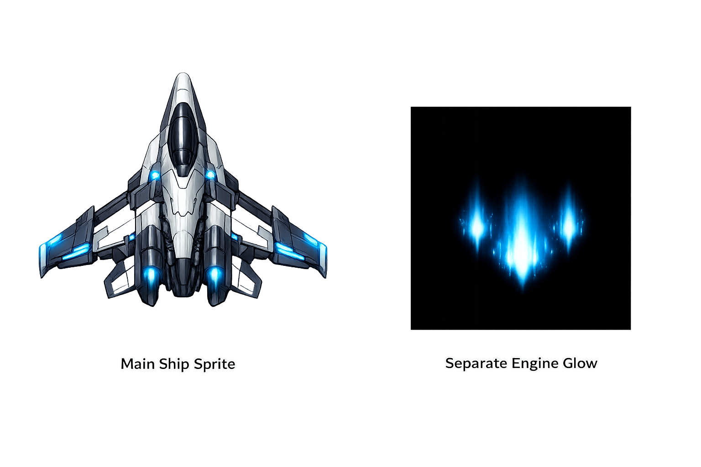
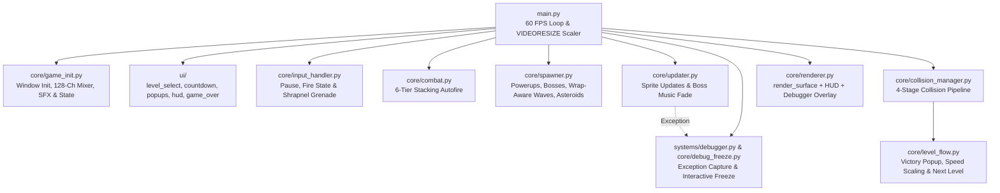

<p align="center"><a href="https://ko-fi.com/todd0042"></a></p>

---

# 🚀 Galaxy-Roids

[](https://www.python.org/)
[](https://www.pygame.org/)
[](generate_music.py)
[-orange.svg)](dist.zip)
[](https://ko-fi.com/todd0042)

> **A fast-paced 60 FPS Python & Pygame arcade space shooter combining classic wrap-around asteroid physics, a 6-tier stacking weapon system, escalating alien enemy waves, multi-phase boss battles, and procedurally synthesized 8-bit/16-bit audio.**

<p align="center">
  
</p>

---

## 📖 Table of Contents

* **Part 1 — User Overview & Quick Start**
  * [🌌 What Is Galaxy-Roids?](#-what-is-galaxy-roids)
  * [✨ Key Features at a Glance](#-key-features-at-a-glance)
  * [🎮 How Gameplay Works](#-how-gameplay-works)
  * [🚀 Quick Start & Installation](#-quick-start--installation)
* **Part 2 — Technical Architecture & Reference**
  * [1. System Architecture & Main Game Loop (main.py, core/game_init.py)](#1-system-architecture--main-game-loop)
  * [2. Player Physics, Stacking Weapons & Projectiles (entities/player.py, core/combat.py, entities/projectiles.py)](#2-player-physics-stacking-weapons--projectiles)
  * [3. Wave Spawning, Enemy Roster & Boss Encounters (core/spawner.py, entities/enemies/, entities/bosses/)](#3-wave-spawning-enemy-roster--boss-encounters)
  * [4. Collision Pipeline & Level Flow (core/collision_manager.py, collisions/, core/level_flow.py)](#4-collision-pipeline--level-flow)
  * [5. Rendering Pipeline, HUD & Exception Debugger Overlay (core/renderer.py, ui/hud.py, systems/debugger.py)](#5-rendering-pipeline-hud--exception-debugger-overlay)
  * [6. Audio Mixer & Procedural Sound Synthesis (systems/audio.py, generate_all_sfx.py, generate_music.py)](#6-audio-mixer--procedural-sound-synthesis)
  * [7. Configuration Reference (settings.py) & Controls](#7-configuration-reference-settingspy--controls)
  * [8. Repository Structure & Verification (sanity_check.py)](#8-repository-structure--verification)
  * [9. License & Support](#9-license--support)

---

# Part 1 — User Overview & Quick Start

## 🌌 What Is Galaxy-Roids?

**Galaxy-Roids** is an arcade-style 2D space shooter built in Python with **Pygame**. Inspired by classic vector shooters like *Asteroids* and modern bullet-hell wave survival games, it pairs inertial ship thruster physics and toroidal screen-wrapping with progressive weapon upgrades, four distinct alien enemy classes, timed boss encounters, and an all-original procedural chiptune soundtrack.

Originally started as a single-file prototype ([Galaxy-roids.py](Galaxy-roids.py)), the codebase was refactored into a modular package architecture across `core/`, `entities/`, `collisions/`, `systems/`, `effects/`, and `ui/`, complete with a resizable render pipeline, joystick/gamepad support, and an in-game exception debugger overlay.

---

## ✨ Key Features at a Glance

* **🛸 Inertial Space Flight & Toroidal Arena**: Smooth ship rotation, forward thrust with animated engine glow and 3-point particle vapor trails, active braking/reverse thrust, and wrap-around screen boundaries.
* **🔫 6-Tier Stacking Weapon Progression**: Collecting powerups stacks your ship's arsenal from single-shot rounds up to 3-way spread fire, rapid-fire cooldown scaling, high-velocity cyan laser beams, and dual wing-mounted homing missiles—plus an on-demand **Shrapnel Grenade** (`Enter` / `Caps Lock`) that bursts into 12 radial fragments.
* **👾 Progressive Enemy Roster**: Unlock four distinct enemy behaviors as you advance through levels: weaving `RegularEnemy` fighters (which begin shooting at Level 13+), movement-trapping `BlobEnemy` slimes (Level 4+), lock-on suicide `BomberEnemy` drones (Level 7+), and high-speed dashing `StingerEnemy` interceptors (Level 10+).
* **👹 Rotating Boss Battles**: Every stage culminates in a timed boss encounter (`BOSS_SPAWN_TIME`), rotating every two levels between **Boss 1 (Planet Breaker)**, **Boss 2 (Sector Guardian)**, and **Boss 3 (Scorpion Dreadnought)**.
* **🎚️ Choose-Your-Challenge Progression**: After defeating each boss, choose **Greater Challenge** (increases enemy and boss speed by `+0.4`), **Just Vibe** (maintains current speed), or **Exit**.
* **🎵 Toggleable 8-Bit & 16-Bit Chiptune Audio**: Switch between `16bit` (default) and `8bit` soundtracks directly from the Level Select screen (`M` key or mouse click). Every SFX and music track is synthesized from scratch using pure Python math in [generate_all_sfx.py](generate_all_sfx.py) and [generate_music.py](generate_music.py).
* **🖥️ Resizable Display & Gamepad Support**: Supports dynamic window resizing (`VIDEORESIZE` smooth-scaled rendering) alongside both keyboard (`WASD` / Arrow keys) and USB/Bluetooth joystick axis controls.
* **🐞 Built-In Interactive Debugger Overlay**: If a sprite raises an unexpected exception during gameplay, [systems/debugger.py](systems/debugger.py) freezes the frame, displays the traceback and recent sprite logs, and supports mouse-drag selection with `Ctrl+C` clipboard copy.

---

## 🎮 How Gameplay Works

1. **Select Your Starting Level & Music Mode**: Launch the game to open the Level Select screen ([ui/level_select.py](ui/level_select.py)). Pick any starting level (`1+`), press `M` to toggle between `16bit` and `8bit` music, and press `Enter` to begin a 3-second countdown.
2. **Survive Waves & Stack Powerups**: Blast splitting asteroids and incoming enemy formations while collecting cyan powerup orbs. Each powerup upgrades your ship's firepower (up to 6 tiers), while taking hits drops your powerup tier by 1.
3. **Defeat the Stage Boss & Scale Difficulty**: Survive until the boss spawns, dodge telegraphed lasers, gravity bombs, and venom hazard pools, and bring down the boss to advance to the next level.

### Quick Controls

| Action | Keyboard | Mouse / Controller |
| :--- | :--- | :--- |
| **Rotate Left / Right** | `A` / `D` or `←` / `→` | Joystick Axis 0 (`< -0.3` / `> 0.3`) |
| **Forward Thrust** | `W` or `↑` | Joystick Axis 1 (`< -0.3`) |
| **Brake / Reverse Thrust** | `S` or `↓` | Joystick Axis 1 (`> 0.3`) |
| **Fire Primary Weapons** | `Space`, `Left Shift`, or `Right Shift` | Hold for rapid-fire at 2+ powerups |
| **Launch Shrapnel Grenade** | `Enter` or `Caps Lock` | — |
| **Pause Menu** | `Esc` | Click menu options / `Enter` |
| **Level Select Controls** | `←`/`→` (`A`/`D`), `M` (Music), `Enter` (Start) | Click level, music, or start prompt |
| **Game Over Screen** | `R` (Restart) / `Q` (Quit) | Click `Restart` or `Quit` |

---

## 🚀 Quick Start & Installation

### Option 1: Run from Source (Linux / macOS / Windows)

Galaxy-Roids requires **Python 3.10+** and **Pygame**:

```bash
# 1. Clone the repository
git clone https://github.com/Todd0042/galaxy-roids.git
cd galaxy-roids

# 2. Create and activate a virtual environment (recommended)
python3 -m venv .venv
source .venv/bin/activate        # Windows: .venv\Scripts\activate

# 3. Install Pygame
pip install pygame

# 4. Run the sanity check (optional)
python3 sanity_check.py

# 5. Launch the game
python3 main.py
```

> **Note:** The repository also retains the original single-file prototype at [Galaxy-roids.py](Galaxy-roids.py), while [main.py](main.py) is the current modular entry point.

### Option 2: Pre-Packaged Linux Bundle (`dist.zip`)

A pre-built PyInstaller distribution archive ([dist.zip](dist.zip)) is included in the repository root (`dist/GalaxyRoids/`). Extract it and run the packaged `GalaxyRoids` binary if targeting a compatible Linux environment.

### Regenerating Procedural Audio Assets (Optional)

All WAV music and SFX files are already committed under `assets/music/` and `assets/sfx/`. To regenerate them from source using only Python's standard library (`wave`, `struct`, `math`, `random`):

```bash
python3 generate_all_sfx.py
python3 generate_music.py
```

If you want to record custom microphone SFX using [record_sfx.py](record_sfx.py), install `sounddevice` and `scipy`:

```bash
pip install sounddevice scipy
python3 record_sfx.py
```

---
---

# Part 2 — Technical Architecture & Reference

> *The sections below document every module, sprite pipeline, enemy/boss state machine, collision phase, audio subsystem, and tuning constant in `galaxy-roids` based directly on the source code.*

---

## 1. System Architecture & Main Game Loop

The refactored game loop in [main.py](main.py) delegates initialization, input, combat, spawning, sprite updates, collisions, level transitions, and rendering to single-responsibility modules under `core/`, `systems/`, `entities/`, `collisions/`, `effects/`, and `ui/`.



### Startup & Resource Resolution ([core/game_init.py](core/game_init.py))
* **PyInstaller-Safe Asset Lookup (`resource_path`)**: Resolves paths relative to `sys._MEIPASS` when frozen by PyInstaller or relative to the working directory when run from source.
* **Window Initialization**: Creates a `1280×720` surface, toggles fullscreen twice to maximize cleanly across desktop managers, and switches to `pygame.RESIZABLE` mode while syncing dynamic `WIDTH` and `HEIGHT` in `state`.
* **60 FPS Frame Loop & Smooth Scaling ([main.py](main.py))**: Renders every frame onto `state["render_surface"]` and scales it via `pygame.transform.smoothscale(render_surface, (WIDTH, HEIGHT))` on `VIDEORESIZE` events.
* **Sprite Groups**: Manages `all_sprites`, `enemies`, `asteroids`, `bullets`, `boss_bullets`, `boss_group`, `trail_group`, `shrapnel_grenades`, `gravity_bombs`, and `powerups`.

---

## 2. Player Physics, Stacking Weapons & Projectiles

### Ship Physics & Visuals ([entities/player.py](entities/player.py), [entities/trail.py](entities/trail.py))
* **Movement Model**: Uses `pygame.Vector2` position, velocity, and direction vectors (`0, -1` rotated by `self.angle`). Forward thrust adds `PLAYER_THRUST` (`0.2`), velocity decays by `PLAYER_FRICTION` (`0.98`) per frame, and braking applies `PLAYER_BRAKE_FRICTION` (`0.95`) plus `PLAYER_REVERSE_THRUST` (`0.03`). Position wraps toroidally (`%= screen_w`, `%= screen_h`).
* **Thruster Glow & 3-Point Vapor Trail**: While `self.thrusting` is active, `assets/player/engine_glow.png` pulses alpha via `math.sin()` and stretches vertically with velocity (`1.0 + min(speed / 12, 0.6)`), while three `TrailSegment` particles spawn behind the center and left/right wing ports with a `20`-frame fade.
* **Hitbox & Damage**: Uses a tight circular hitbox (`PLAYER_HITBOX_RADIUS = 4.5` px) decoupled from the outer sprite rect, with `PLAYER_INVULN_TIME = 60` frames, `PLAYER_STUN_TIME = 10` frames, hit flash (`6` frames), and screen shake hooks.
* **Dedicated Audio Channels**: Reserves `pygame.mixer.Channel(7)` for looping engine thrust audio and `pygame.mixer.Channel(8)` for the low-health warning alarm (`health_ratio <= 0.25`).

### 6-Tier Stacking Weapon Progression ([core/combat.py](core/combat.py), [entities/powerups.py](entities/powerups.py))

Collecting `Powerup` orbs increments `player.powerup_hits` and cumulatively stacks weapon systems inside `handle_autofire()`:

| `powerup_hits` | Weapon Mode | Unlocked Capabilities & Cooldowns |
| :---: | :--- | :--- |
| **`0`** | `NORMAL` | Single `Bullet` per press-and-release (`single_shot_fired` lock prevents holding). |
| **`1`** | `SPREAD` | Adds 3-way spread shot (`-15°`, `0°`, `+15°` offsets). |
| **`2`** | `SPREAD` (Rapid) | Unlocks continuous hold-to-fire (`RAPID_FIRE_COOLDOWN = 20` ms for primary shot). |
| **`3`** | `SPREAD` (Faster) | Reduces `player.fire_cooldown` formula (`max(2, 10 - powerup_hits * 2)`). |
| **`4`** | `SPREAD` + Laser | Fires cyan `LaserBeam` (`6×40`, speed `25`) every `LASER_FIRE_COOLDOWN = 10` frames. |
| **`5`** | + Left Homing | Launches left wing `HomingMissile` (`-45°` launch offset) every `HOMING_FIRE_COOLDOWN = 20` frames. |
| **`6+`** | + Dual Homing | Adds right wing `HomingMissile` (`+45°` launch offset). |

### Projectiles & Hazards ([entities/projectiles.py](entities/projectiles.py))
* **`Bullet`**: Standard projectile (`BULLET_SPEED = 10`), also used for 12-way shrapnel fragments (`is_bomber_fragment=True`).
* **`ShrapnelBullet`**: Launched on `Enter` / `Caps Lock` (`SHRAPNEL_COOLDOWN_MAX = 120` frames). Explodes on asteroid/enemy impact or timer expiry via `spawn_shrapnel_explosion()` into 12 radial fragments (`30°` increments).
* **`LaserBeam`**: High-speed (`25` px/frame) cyan beam unlocked at `powerup_hits >= 4`.
* **`HomingMissile`**: Launches laterally for `18` frames (`launch_frames=18`), acquires the nearest sprite in `groups["enemies"]`, and accelerates up to speed `20`.
* **`GravityBomb`** & **`Boss2LaserBeam`**: Boss 2 weapons; `GravityBomb` pulses radially until `dist_traveled >= target_dist`, while `Boss2LaserBeam` grows into a rotated red/glow cone (`damage = 7` per frame) with a world-space `world_hitbox`.
* **`VenomOrb`** & **`HazardPool`**: Boss 3 weapons; `VenomOrb` falls under `VENOM_ORB_GRAVITY` (`0.18`), bounces once off the lower arena (`VENOM_ORB_BOUNCE_FACTOR = -0.45`), and bursts into a pulsing green `HazardPool` (`240` frames duration) that inflicts DOT and slows the player.

---

## 3. Wave Spawning, Enemy Roster & Boss Encounters

### Wrap-Aware Wave & Asteroid Spawning ([core/spawner.py](core/spawner.py), [systems/level_manager.py](systems/level_manager.py))
* **Toroidal Spawn Protection (`wrapped_distance`)**: `random_spawn_pos()` computes the shortest distance across wrap-around edges (`min(dx, WIDTH - dx)`, `min(dy, HEIGHT - dy)`) so enemies never pop directly beside the player across a screen boundary (`min_dist = 220` px for Regular/Blob, `480` px for Bomber/Stinger).
* **Dynamic Wave Scaling (`spawn_periodic_enemy_waves`)**: Wave interval starts at `2000` ms and compresses based on `level_factor` (floor `0.35`), `power_factor` (floor `0.45`), and `time_factor` (floor `0.5`). Wave size scales with `2 + level // 3 + powerup_hits // 2 + min(4, elapsed // 15000)`.
* **Asteroids ([entities/asteroid.py](entities/asteroid.py))**: Spawned at level start (`ASTEROID_START_COUNT + (level - 1) * ASTEROID_SCALING`, capped at `ASTEROID_MAX_COUNT = 8`) and periodically every ~7 seconds. Size `3` (`HP=3`) and size `2` (`HP=2`) split into two smaller asteroids until size `1` (`HP=1`) is destroyed.

### Modular Enemy Roster ([entities/enemies/](entities/enemies/))

All enemies inherit from [`BaseEnemy`](entities/enemies/base_enemy.py), which handles animated wing flapping, dynamic screen bounds, movement/attack hooks, and `SplatterParticle` death bursts ([effects/splatter.py](effects/splatter.py)):

| Class | Unlock Level | Wave Cap | Movement & Attack Mechanics |
| :--- | :---: | :---: | :--- |
| [`RegularEnemy`](entities/enemies/regular_enemy.py) | Level `1+` | `16` | Sinusoidal weaving pursuit toward player; unlocks projectile firing (`can_shoot`) at Level `13+`. |
| [`BlobEnemy`](entities/enemies/blob_enemy.py) | Level `4+` | `8` | Slow (`0.55x`) wobbling slime with toroidal screen wrapping; applies contact trap/damage (`BLOB_TRAP_TIME = 500` ms). |
| [`BomberEnemy`](entities/enemies/bomber_enemy.py) | Level `7+` | `4` | `2000` ms spawn freeze, then `CHARGING` (`400` ms) $\rightarrow$ `DASHING` (speed `9.0` toward locked target) $\rightarrow$ `EXPLODING` (`BOMBER_DAMAGE = 25`). |
| [`StingerEnemy`](entities/enemies/stinger_enemy.py) | Level `10+` | `4` | `2000` ms spawn freeze, then `ROAMING` (`2.2` speed) $\rightarrow$ `DASHING` (speed `8.5`) $\rightarrow$ `RECOVERY` (`350` ms), dealing `STINGER_DAMAGE = 20`. |

### Boss Rotation & Boss Mechanics ([entities/bosses/](entities/bosses/), [core/spawner.py](core/spawner.py))

When `pygame.time.get_ticks() - level_start_time >= BOSS_SPAWN_TIME` (`60000` ms default, with music cross-fading 5 seconds prior in `core/updater.py`), `get_boss_for_level(level)` spawns the active boss in 2-level pairs (with all bosses inheriting `BaseBoss` and capped at `MAX_BOSS_HEALTH = 2000`):

* **`Boss1` — Planet Breaker ([entities/bosses/boss1_planet_breaker.py](entities/bosses/boss1_planet_breaker.py), Levels 1–2)**: Sweeps horizontally (`screen_w // 4` amplitude) and fires a telegraphed downward laser beam (`BOSS_LASER_WARNING = 90` frames warning, `BOSS_LASER_DURATION = 180` frames active, `BOSS_LASER_COOLDOWN = 600` frames).
* **`Boss2` — Sector Guardian ([entities/bosses/boss2_sector_guardian.py](entities/bosses/boss2_sector_guardian.py), Levels 3–4)**: Flies in a figure-eight pattern, launches `GravityBomb` charges across a downward `135°–225°` cone, and on even-numbered levels fires a 3-way `Boss2LaserBeam` spread (`165°`, `180°`, `195°`) while slowing to `0.25x` speed.
* **`Boss3` — Scorpion Dreadnought ([entities/bosses/boss3_template.py](entities/bosses/boss3_template.py), Levels 5–6)**: Tracks the player horizontally with periodic edge dashes (`2.5x` speed), wields a 3-segment articulated tail (`tail_segments`) that telegraphs and strikes downward, spawns 3-way bouncing `VenomOrb` projectiles, and defines a `weakspot_rect` (`100%` damage vs. `25%` armored body damage).
* *(Note: [`boss4_template.py`](entities/bosses/boss4_template.py) and [`boss5_template.py`](entities/bosses/boss5_template.py) are stub templates reserved for future boss expansion; [`entities/boss.py`](entities/boss.py) holds legacy pre-refactor boss classes.)*

---

## 4. Collision Pipeline & Level Flow

### 4-Stage Collision Orchestration ([core/collision_manager.py](core/collision_manager.py))
Every frame, `process_collisions()` executes four ordered passes:
1. **`handle_player_enemy_collisions`** ([collisions/collision_player_enemy.py](collisions/collision_player_enemy.py)): Resolves player bullets, `ShrapnelBullet` impacts/explosions, and `is_bomber_fragment` pellets against enemies (`+10` score per kill, spawns `SplatterParticle`).
2. **`handle_enemy_player_collisions`** ([collisions/collision_enemy_player.py](collisions/collision_enemy_player.py)): Uses fast squared-distance `circle_hit()` checks for player hitbox vs. enemies, asteroids, boss body, and boss bullets, plus `HazardPool` DOT (`HAZARD_DAMAGE = 2` every `12` frames) and slow (`HAZARD_SLOW_MULT = 0.5`, `HAZARD_LINGER_MULT = 0.7` for `60` frames). On lethal damage, `handle_player_death()` ([core/player_state.py](core/player_state.py)) decrements `state["lives"]` and respawns at screen center with invulnerability + brief stun until lives reach `0`.
3. **`handle_misc_collisions`** ([collisions/collision_misc.py](collisions/collision_misc.py)): Damages asteroids (triggering `Asteroid.split()` on `health <= 0`), detonates shrapnel grenades on asteroid contact, and applies `Powerup.apply(player)` on pickup.
4. **`handle_boss_collisions`** ([collisions/collision_boss.py](collisions/collision_boss.py)): Applies `BULLET_DAMAGE` (`1`) and `SHRAPNEL_DAMAGE` (`10`) to the active boss, and checks boss vertical lasers, Boss 3 tail strikes, and Boss 2 `world_hitbox` beams against the player.

### Post-Boss Level Flow ([core/level_flow.py](core/level_flow.py))
When `handle_boss_collisions()` returns `True`, `handle_boss_defeat()` plays the victory stinger, opens `show_victory_popup()` ([ui/popups.py](ui/popups.py)), optionally scales `current_enemy_speed` and `current_boss_speed` by `+0.4` if **"Greater Challenge"** is selected, increments `state["level"]`, caps `player.powerup_hits` to `min(player.powerup_hits, 1)` for the new stage, and invokes `systems.level_manager.start_level()`.

---

## 5. Rendering Pipeline, HUD & Exception Debugger Overlay

* **Pure Renderer ([core/renderer.py](core/renderer.py))**: Draws layers strictly back-to-front with zero game logic:
  1. Screen shake offset (`SCREEN_SHAKE_TIMER`, `SCREEN_SHAKE_INTENSITY`)
  2. Black background fill & `trail_group` vapor trails
  3. Player thruster `engine_glow_scaled` sprite behind the ship
  4. `all_sprites` (player, enemies, asteroids, projectiles, bosses, powerups, splatter)
  5. Boss active laser overlays (`draw_laser`, `draw_extra`)
  6. Unshaken HUD ([ui/hud.py](ui/hud.py)) & `DebuggerOverlay` ([systems/debugger.py](systems/debugger.py))
* **HUD Layout ([ui/hud.py](ui/hud.py))**:
  * **Top-Left**: `HP` bar, `SHOT` shrapnel cooldown bar, `LIVES`, `SCORE`, and `DIFFICULTY`.
  * **Top-Right**: `BOSS` health bar (visible when a boss is active).
  * **Bottom-Center**: Current `WEAPON` mode (`NORMAL` / `SPREAD`) and 6-segment `POWERUPS` bar.
  * **Bottom-Right**: Live `FPS` readout.
* **Interactive Exception Debugger ([systems/debugger.py](systems/debugger.py), [core/debug_freeze.py](core/debug_freeze.py))**: Wraps `update_all_sprites()` in a `try/except`; on any sprite crash, pauses the game loop in `debugger_freeze_loop()`, displays the last 12 traceback lines, last updated sprite class, and recent event log, lets you drag-select lines and press `Ctrl+C` to copy via `pygame.scrap`, and press `R` to resume or `Q` to quit.

---

## 6. Audio Mixer & Procedural Sound Synthesis

### Runtime Audio Manager ([systems/audio.py](systems/audio.py))
* Allocates `128` mixer channels at startup (`pygame.mixer.set_num_channels(128)`).
* Enforces anti-spam controls in `play_sfx()`: per-sound cooldowns (`sfx_cooldowns`), rapid-fire spacing (`RAPID_FIRE_MIN_SPACING = 0.15` s for `laser`, `weapon_pew`, `weapon_spread`), and `MAX_INSTANCES` caps (`1` concurrent channel for rapid-fire weapons and `boss_laser`).
* Supports dual-era chiptune music via `audio.music_mode` (`"16bit"` default or `"8bit"`), loading `assets/music/<mode>/<track_name>.wav` (`menu_theme.wav`, `level_theme_1.wav`, `boss_theme.wav`, `victory_theme.wav`, `game_over_theme.wav`).

### Clean-Room Procedural Audio Generators
Every sound effect and music track in `assets/` is generated mathematically in pure Python (`wave`, `struct`, `math`, `random`) with no external audio samples:
* **[generate_all_sfx.py](generate_all_sfx.py)**: Synthesizes `44.1 kHz` 16-bit mono WAVs across `assets/sfx/` (`player/`, `weapons/`, `powerups/`, `asteroids/`, `bosses/`, `bosses/boss1/`, `bosses/boss2/`, `bosses/boss3/`, `ui/`, `level/`).
* **[generate_music.py](generate_music.py)**: Synthesizes `22.05 kHz` 16-bit mono looping themes for both `assets/music/16bit/` and `assets/music/8bit/` using square/triangle oscillators, exponential decay drum voices (`drum_kick`, `drum_snare`, `drum_hat`), and harmonic pads. *(Older/experimental generator variants are preserved in [generate_music2.py](generate_music2.py) and [generate_music_broken.py](generate_music_broken.py).)*

---

## 7. Configuration Reference (`settings.py`) & Controls

Key gameplay tuning constants live in [settings.py](settings.py):

| Constant | Default | Description |
| :--- | :--- | :--- |
| `FPS` | `60` | Target frame rate (`clock.tick(60)`). |
| `DIFFICULTY_MULTIPLIER` | `0.3` | Global scaler applied to `ENEMY_SPEED`, `ENEMY_DIVE_CHANCE`, `BOSS_SPEED_BASE`, and `BOSS_HEALTH_BASE`. |
| `PLAYER_MAX_HEALTH` / `INITIAL_LIVES` | `100` / `15` | Starting health pool per life and total lives. |
| `PLAYER_SCALE` / `PLAYER_HITBOX_RADIUS` | `0.25` / `4.5` | Ship sprite scale multiplier and circular collision radius (px). |
| `PLAYER_THRUST` / `PLAYER_FRICTION` / `PLAYER_ROT_SPEED` | `0.2` / `0.98` / `4` | Ship acceleration, velocity damping, and rotation speed (degrees/frame). |
| `LASER_FIRE_COOLDOWN` / `HOMING_FIRE_COOLDOWN` | `10` / `20` | Frames between laser and homing missile volleys once unlocked. |
| `RAPID_FIRE_COOLDOWN` / `SHRAPNEL_COOLDOWN_MAX` | `20` / `120` | Rapid-fire interval (ms) and shrapnel grenade cooldown (frames). |
| `BOSS_SPAWN_TIME` | `60000` | Elapsed level time (ms) before the stage boss spawns. |
| `BOSS_HEALTH_BASE` / `MAX_BOSS_HEALTH` | `350 * 0.3` / `2000` | Base boss HP before level scaling and global HP cap. |
| `BOSS_LASER_COOLDOWN` / `DURATION` / `WARNING` | `600` / `180` / `90` | Boss 1 laser cycle timings in frames. |
| `HAZARD_POOL_DURATION` / `HAZARD_DOT_INTERVAL` | `240` / `12` | Boss 3 venom pool lifetime and DOT tick interval (frames). |
| `ASTEROID_START_COUNT` / `ASTEROID_MAX_COUNT` | `2` / `8` | Starting asteroid count and level-scaled cap. |
| `POWERUP_SPAWN_CHANCE` | `0.01` | Per-frame / asteroid-destruction powerup spawn probability. |

---

## 8. Repository Structure & Verification

```text
galaxy-roids/
├── main.py                              # Modular 60 FPS game loop & VIDEORESIZE display handler
├── settings.py                          # Centralized gameplay, physics, damage & boss tuning constants
├── sanity_check.py                      # Automated import, directory & pygame subsystem sanity checker
├── Galaxy-roids.py                      # Original single-file prototype (1,123 lines)
├── BCO.cf1e6bb1-d81b-4455-82ea-53e90b3ad27f.png # Player ship & engine glow sprite reference sheet
├── dist.zip                             # Packaged PyInstaller Linux build (dist/GalaxyRoids/)
├── generate_all_sfx.py                  # Procedural 44.1 kHz WAV synthesizer for all game SFX
├── generate_music.py                    # Procedural 22.05 kHz 8-bit & 16-bit music track generator
├── generate_music2.py                   # Alternate/legacy music generator script
├── generate_music_broken.py             # Archived experimental music generator
├── record_sfx.py                        # Optional sounddevice/scipy mic WAV recorder utility
├── core/                                # Engine orchestration & loop subsystems
│   ├── game_init.py                     # Display setup, 128-ch mixer, SFX loader & initial state dict
│   ├── input_handler.py                 # Keyboard fire/pause/shrapnel event handling
│   ├── combat.py                        # 6-tier stacking weapon autofire logic
│   ├── spawner.py                       # Wrap-aware enemy waves, powerups, asteroids & boss rotation
│   ├── updater.py                       # Sprite update dispatcher & pre-boss music fade trigger
│   ├── collision_manager.py             # 4-stage collision orchestrator
│   ├── level_flow.py                    # Post-boss victory popup, speed scaling & level advancement
│   ├── player_state.py                  # Player death, life decrement & respawn state reset
│   ├── powerup_spawner.py               # PowerupSpawner helper class
│   ├── renderer.py                      # Pure back-to-front frame renderer & screen shake offset
│   └── debug_freeze.py                  # Interactive debugger pause loop (R to resume, Q to quit)
├── entities/                            # Game entities & modular enemy/boss hierarchies
│   ├── player.py                        # Player ship physics, thruster glow, trails & audio channels
│   ├── projectiles.py                   # Bullet, ShrapnelBullet, LaserBeam, HomingMissile, GravityBomb, VenomOrb, HazardPool, Boss2LaserBeam
│   ├── asteroid.py                      # 3-tier splitting Asteroid sprite
│   ├── powerups.py                      # Stacking Powerup orb
│   ├── trail.py                         # Fading engine TrailSegment particle
│   ├── boss.py                          # Legacy pre-refactor Boss / Boss2 classes
│   ├── enemies/                         # BaseEnemy, RegularEnemy, BlobEnemy, BomberEnemy, StingerEnemy
│   └── bosses/                          # BaseBoss, Boss1 (Planet Breaker), Boss2 (Sector Guardian), Boss3 (Scorpion Dreadnought), Boss4/Boss5 templates
├── collisions/                          # Specialized collision handlers
│   ├── collision_player_enemy.py        # Bullets, shrapnel & fragments vs. enemies
│   ├── collision_enemy_player.py        # Enemies, asteroids, boss body/bullets & HazardPool vs. player
│   ├── collision_misc.py                # Asteroids, shrapnel impacts & powerup pickups
│   └── collision_boss.py                # Player weapons vs. boss & boss lasers/tail strikes vs. player
├── effects/
│   └── splatter.py                      # SplatterParticle radial death burst
├── systems/
│   ├── audio.py                         # 128-channel SFX cooldown/instance limiter & 8-bit/16-bit music loader
│   ├── debugger.py                      # Traceback & event-log DebuggerOverlay with clipboard copy
│   └── level_manager.py                 # Level entity reset, asteroid field & edge formation spawner
├── ui/
│   ├── level_select.py                  # Starting level & 8-bit/16-bit music toggle menu
│   ├── countdown.py                     # 3-2-1 pre-stage countdown screen
│   ├── hud.py                           # Health, cooldown, lives, score, boss HP, weapon tier & FPS HUD
│   ├── popups.py                        # Generic popup menu, Pause menu & Post-boss Victory menu
│   └── game_over.py                     # Game Over screen with Restart (R) / Quit (Q)
└── assets/
    ├── player/                          # player_ship.png, engine_glow.png
    ├── music/{8bit,16bit}/              # menu_theme, level_theme_1, boss_theme, victory_theme, game_over_theme (.wav)
    ├── sfx/                             # Procedural WAV SFX across asteroids, bosses, level, player, powerups, ui, weapons
    └── retro.ttf                        # Arcade font asset
```

### Running the Sanity Check
To verify that Pygame initializes cleanly, all required package directories and `__init__.py` files exist, and all 31 game modules import without errors:

```bash
python3 sanity_check.py
```

---

## 9. License & Support

* **License**: [PolyForm Noncommercial License 1.0.0](LICENSE) — free for personal, hobby, educational, research and nonprofit use; commercial use (inside a company, in a paid product or service, or for profit) requires a separate license from [Todd0042](https://github.com/Todd0042).
* **Media License**: the images, artwork and audio made for this project (paths listed in [LICENSE-MEDIA](LICENSE-MEDIA)) are © Todd0042 under **[CC BY-NC 4.0](LICENSE-MEDIA)**: free to share and adapt with credit for non-commercial purposes; commercial use requires permission.
* **Third-Party Libraries**: Built with [Pygame](https://www.pygame.org/) (LGPL).

<p align="center">
  If you enjoy Galaxy-Roids, consider supporting its development:<br/><br/>
  <a href="https://ko-fi.com/todd0042" target="_blank">
    
  </a>
</p>

---

<p align="center"><a href="https://ko-fi.com/todd0042"></a></p>
